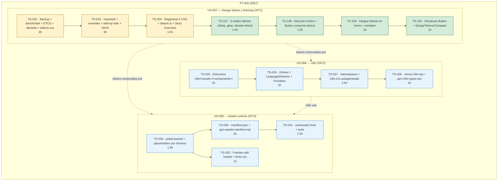

# FT-002 — Design tokens, i18n y assets runtime (#557)

> **Estado**: Backlog → Ready (pendiente).
> **Capability**: CAP-01 — Base del frontend React 19 + TS 6 + Vite 8.
> **Depende de**: FT-001 (#556) cerrada.
> **US**: US-007 (#571) · US-008 (#572) · US-009 (#573).

## Resumen

Formaliza los design tokens (DTCG 2025.10 + Style Dictionary v5) con
ajustes de branding propio, activa i18n (es/en) con namespaces por
componente y sirve assets runtime desde `public/assets/`. Aplica tokens

- motion al Button, lo integra en la home manteniendo el contador de
  clicks, y expone 3 demos de motion para elección del usuario.

## Plan de ejecución — 3 US · 15 TS

## Tabla de tareas

### US-007 — Design tokens y theming

| ID         | Título                                                            | Acción  | Est. | Depende |
| ---------- | ----------------------------------------------------------------- | ------- | ---- | ------- |
| TS-022     | Backup + benchmark (enfoques de tokens) + DTCG + decisión + tokens-css doc | rewrite | 4h   | —       |
| TS-023     | imported/ + brand-overrides + side-by-side + Style Dictionary v5  | rewrite | 4h   | TS-022  |
| TS-024     | Regenerar 5 CSS + tokens.ts + Story DesignTokens actualizada      | rewrite | 1.5h | TS-023  |
| **TS-147** | 3 motion demos (shine sweep, glow pulse, vibrate+shine)           | **new** | 1.5h | TS-024  |
| **TS-148** | Elección motion + Button consume tokens                           | **new** | 1.5h | TS-147  |
| **TS-149** | Integrar Button en home + mantener contador de clicks             | **new** | 1h   | TS-148  |
| **TS-150** | Storybook Button + Story DesignTokens/Compare                     | **new** | 1h   | TS-149  |

**Subtotal US-007: 15h**

### US-008 — i18n con namespaces

| ID     | Título                                                   | Acción  | Est. | Depende |
| ------ | -------------------------------------------------------- | ------- | ---- | ------- |
| TS-025 | Estructura `i18n/<locale>/<componente>/*.json`           | rewrite | 2h   | US-007  |
| TS-026 | i18next + LanguageDetector + Providers                   | rewrite | 2h   | TS-025  |
| TS-027 | Namespaces + `i18n.d.ts` autogenerado + story `withI18n` | rewrite | 2.5h | TS-026  |
| TS-028 | `check-i18n.mjs` + `gen-i18n-types.mjs`                  | rewrite | 2h   | TS-027  |

**Subtotal US-008: 8.5h**

### US-009 — Assets runtime

| ID     | Título                                                     | Acción  | Est. | Depende |
| ------ | ---------------------------------------------------------- | ------- | ---- | ------- |
| TS-029 | `public/assets/` + placeholders por dominio                | rewrite | 1.5h | US-007  |
| TS-030 | `manifest.json` + `gen-assets-manifest.mjs`                | rewrite | 2h   | TS-029  |
| TS-031 | `useAsset()` hook + tests                                  | rewrite | 1.5h | TS-030  |
| TS-032 | Fuentes self-hosted + `fonts.css` con `font-display: swap` | rewrite | 1h   | TS-029  |

**Subtotal US-009: 6h**

**Total estimado FT-002: ~29.5h**

## Decisiones de refinamiento (2026-11-01)

- **13 preguntas de alcance resueltas** (i18n ×7, assets ×6).
- **DTCG escrito a mano** aceptado; sync es paid → export manual.
- **DTCG base**: se elige entre Made Good Designs / IBM Carbon en TS-022.
- **Motion del Button**: 3 demos → elección del usuario en TS-148.
- **Visual regression**: diferido a task futura.
- **URL estable sin hash** para assets.
- **i18n.d.ts autogenerado** (union de claves) aprobado.

## Criterios de aceptación (release)

Heredados del FT-template v2 (5 CAs estándar): merge `developer→lastest`,
bump hotfix `014→015`, bump docs versionados, US hijas cerradas, FT cerrada.

## Referencias

- [W3C DTCG Format Module 2025.10](https://www.designtokens.org/tr/2025.10/format/)
- [Style Dictionary v5](https://styledictionary.com/)
- [DTCG spec](https://www.designtokens.org/tr/2025.10/format/)
- [DTCG base](https://www.designtokens.org/tr/2025.10/format/)
