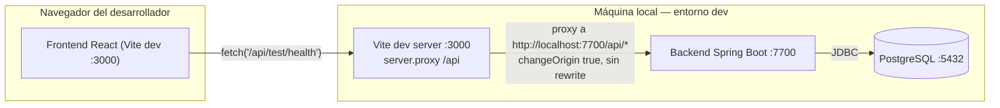
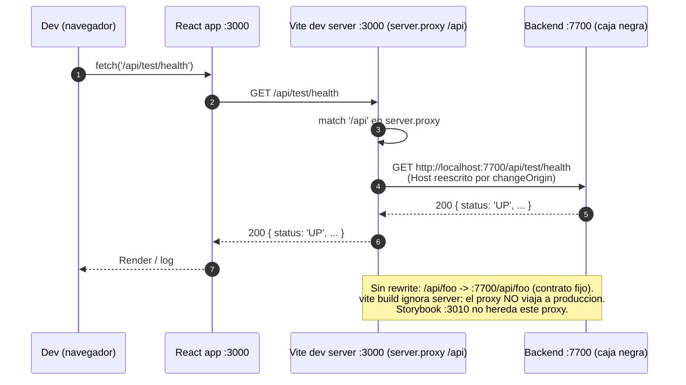

# Proxy de desarrollo `/api` — `vite.config.ts`

> **Tarea**: TS-020 (#625) — `vite.config.ts` con proxy `/api`.
> **Feature**: US-006 (#570) — Variables de entorno y proxy `/api`.
> **Archivo**: `frontend/vite.config.ts`.
> **Guía completa**: [`convenciones/proxy-developer.md`](../convenciones/proxy-developer.md).

El proxy de Vite permite que el frontend en dev (`:3000`) consuma `/api/*`
contra el backend (`:7700`) sin CORS y sin hardcodear el puerto del backend
en el código React. Solo aplica a `npm run dev` (por diseño de Vite: `vite build`
ignora la clave `server`).

## A. Diagrama gerencial — capas como cajas negras

### Componentes y qué hace cada uno

| Componente                    | Qué hace                                                                                                                                                      |
| :---------------------------- | :------------------------------------------------------------------------------------------------------------------------------------------------------------ |
| Frontend React (`:3000`)      | Consume `/api/*` con `fetch`/axios relativo, sin hardcodear `:7700` ni el host.                                                                               |
| Vite dev server (`:3000`)     | Intercepta `/api/*` vía `server.proxy` y lo reenvía al backend. `changeOrigin: true` reescribe el header `Host`. Sin `rewrite`: el path `/api/*` se preserva. |
| Backend Spring Boot (`:7700`) | Expone `/api/*` (auth, encryption, test). Puerto `application.yml → server.port`.                                                                             |
| PostgreSQL (`:5432`)          | Persistencia (caja negra para el frontend).                                                                                                                   |

## B. Diagrama técnico frontend — secuencia

### Funciones / configuración

| Pieza                          | Parámetros                                              | Respuesta              | Qué hace                                                             |
| :----------------------------- | :------------------------------------------------------ | :--------------------- | :------------------------------------------------------------------- |
| `server.proxy['/api']`         | `target: 'http://localhost:7700'`, `changeOrigin: true` | Proxy HTTP al backend  | Reenvía toda petición bajo `/api/*` al backend.                      |
| Sin `rewrite`                  | —                                                       | Path preservado        | `/api/foo` → `http://localhost:7700/api/foo`.                        |
| Sin `preview.proxy`            | —                                                       | `vite preview` intacto | Solo dev. `vite build` no incluye proxy.                             |
| Comentario en `vite.config.ts` | —                                                       | —                      | Apunta a `backend/src/main/resources/application.yml → server.port`. |

## Sincronización de puerto

El puerto `7700` en `vite.config.ts` **debe** coincidir con
`backend/src/main/resources/application.yml → server.port`. El comentario
del bloque `proxy` guía al siguiente dev a mantenerlos sincronizados.

Si el backend cambia de puerto:

1. Actualizar `application.yml → server.port`.
2. Actualizar `frontend/vite.config.ts → server.proxy['/api'].target`.
3. Actualizar este doc.

Sin `rewrite` el contrato `/api/*` se mantiene estable entre dev, backend y
(donde aplique) nginx.
