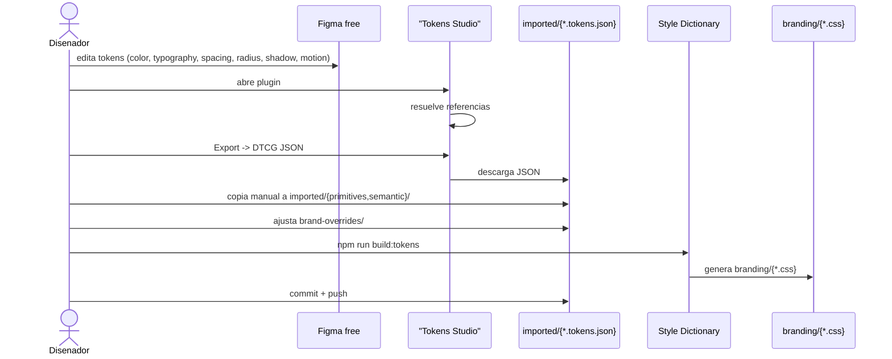
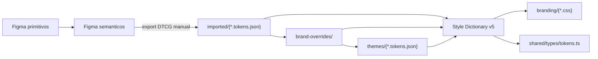

# Flujo Figma free + Tokens Studio -> DTCG -> Style Dictionary

> **Task**: TS-022 (#627). **Feature**: FT-002 (#557). **Fecha**: 2026-11-03.
> **Ruta oficial de tokens**: frontend/src/components/imported/

## 1. Alcance

Este documento describe el flujo de autoria y export de design tokens.
No cubre la implementacion ni el pipeline completo (vive en TS-023 y TS-024).

Fuera del alcance: sync automatico (paid), Figma Enterprise, export a iOS/Android.

## 2. Herramientas elegidas

| Herramienta         | Rol                                  | Plan        |
| :------------------ | :----------------------------------- | :---------- |
| Figma free          | Autoria visual de tokens             | Free        |
| Tokens Studio free  | Plugin Figma para exportar DTCG JSON | Free        |
| Style Dictionary v5 | Compilador DTCG -> CSS + TS          | Open source |

### Limitaciones del plan free

- Figma free: 1 modo por coleccion. Los temas multi-modo (light/dark/high-contrast) viven en frontend/src/components/imported/themes/{*.tokens.json}, no en Figma.
- Tokens Studio free: sin sync automatico a GitHub. Export manual (boton Export -> DTCG JSON).

## 3. Setup Figma free (primera vez)

1. Crear cuenta gratis en figma.com
2. Crear team free (1 archivo Tokens alcanza)
3. Instalar plugin Tokens Studio for Figma (Plugins -> Browse)
4. Configurar sets: primitives, light, dark, high-contrast
5. Export format: DTCG JSON
6. No configurar sync a GitHub (requiere paid)

## 4. Flujo de autoria -> commit

### Diagrama de secuencia (Mermaid)

### Diagrama de capas (Mermaid)

## 5. Estructura de tokens

Ruta oficial: frontend/src/components/imported/

- primitives/ (color, typography, spacing, radius, shadow, motion)
- semantic/atoms/ (buttons, cards, searchbar)
- semantic/layout/ (grid)
- themes/ (light, dark, high-contrast)
- brand-overrides/ (color, typography, motion)

## 6. Pipeline

1. Editar tokens en Figma + Tokens Studio.
2. Export DTCG JSON manual -> copiar a frontend/src/components/imported/.
3. Ajustar brand-overrides/.
4. cd frontend && npm run build:tokens.
5. Verificar output: branding/{*.css} + shared/types/tokens.ts.
6. Commit + push.

## 7. Rollback

Si el export falla o la generacion no convence:

- Restaurar CSS: cp frontend/src/styles/branding-backup-v0.1.14/*.css frontend/src/styles/branding/
- Descartar pipeline: git checkout frontend/src/components/imported/ frontend/style-dictionary.config.js frontend/package.json

## 8. Referencias

- W3C DTCG 2025.10: https://www.designtokens.org/tr/2025.10/format/
- Style Dictionary: https://styledictionary.com/
- Tokens Studio: https://tokens.studio/
- Benchmark: ../../convenciones/benchmark-tokens-2026.md
