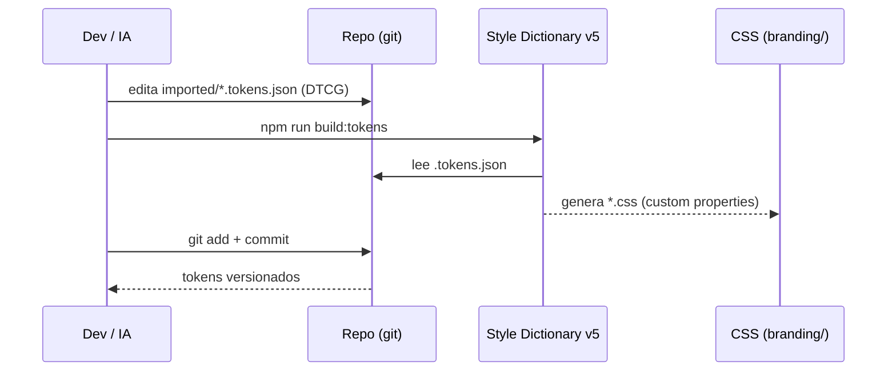
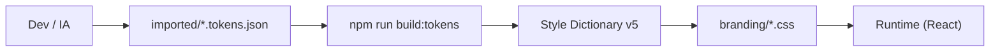

# Flujo de design tokens: DTCG escrito a mano → Style Dictionary

> **Task**: TS-022 (#627). **Feature**: FT-002 (#557). **Fecha**: 2026-11-03 (actualizado 2026-11-08).
> **Ruta oficial de tokens**: `frontend/src/components/imported/`

## 1. Alcance

Este documento describe el flujo de autoría y export de design tokens.
No cubre la implementación ni el pipeline completo (vive en TS-023 y TS-024).

**Decisión**: los tokens se escriben a mano en formato DTCG (o se generan
con IA). No se usa Figma ni Tokens Studio. La razón: Figma no aporta valor
en un contexto de un solo desarrollador sin equipo de diseño, y añade una
capa de fricción (autoría visual → export → código) que Storybook + código
directo no tienen.

Fuera del alcance: sync automático a GitHub, export a iOS/Android.

## 2. Herramientas elegidas

| Herramienta | Rol | Plan |
| :-- | :-- | :-- |
| DTCG escrito a mano | Autoría de tokens (JSON con `$value`, `$type`) | N/A |
| Style Dictionary v5 | Compilador DTCG → CSS + TS | Open source |

## 3. Estructura de archivos DTCG

Los archivos viven en `frontend/src/components/imported/`:

- `primitives.tokens.json` — valores base (colores, spacing, tipografía).
- `themes/light.tokens.json` — tokens semánticos del tema light.
- `themes/dark.tokens.json` — tokens semánticos del tema dark.
- `themes/high-contrast.tokens.json` — tokens semánticos del tema high-contrast.

Ejemplo mínimo de DTCG:

```json
{
  "color": {
    "primary": {
      "$value": "#0a66c2",
      "$type": "color",
      "$description": "Color primario de la marca"
    }
  }
}
```

## 4. Flujo de autoría → commit

1. Editar/crear `.tokens.json` en `frontend/src/components/imported/`.
2. Ejecutar `npm run build:tokens` (Style Dictionary).
3. Style Dictionary genera `frontend/src/styles/branding/*.css` con CSS custom properties.
4. Commitear tanto los `.tokens.json` como los `.css` generados.

## 5. Diagrama de secuencia (Mermaid)



## 6. Diagrama de flujo (Mermaid)



## 7. Limitaciones y decisiones

- Sin sync automático: los tokens se versionan en git, no en una herramienta externa.
- Los temas (light/dark/high-contrast) viven en archivos DTCG separados.
- Sin Figma: si en el futuro entra un diseñador, se puede añadir como capa opcional sin romper el pipeline.
